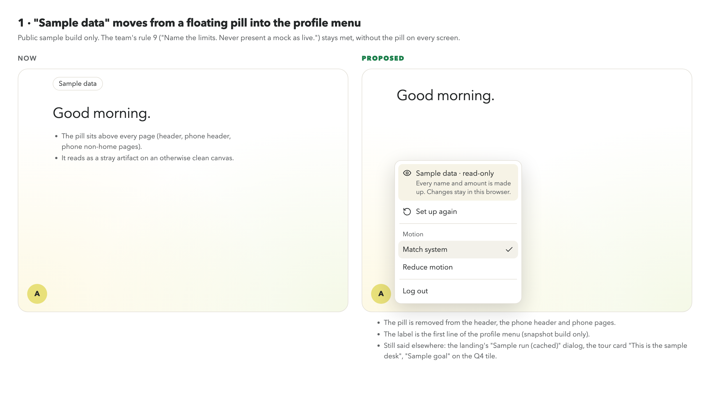
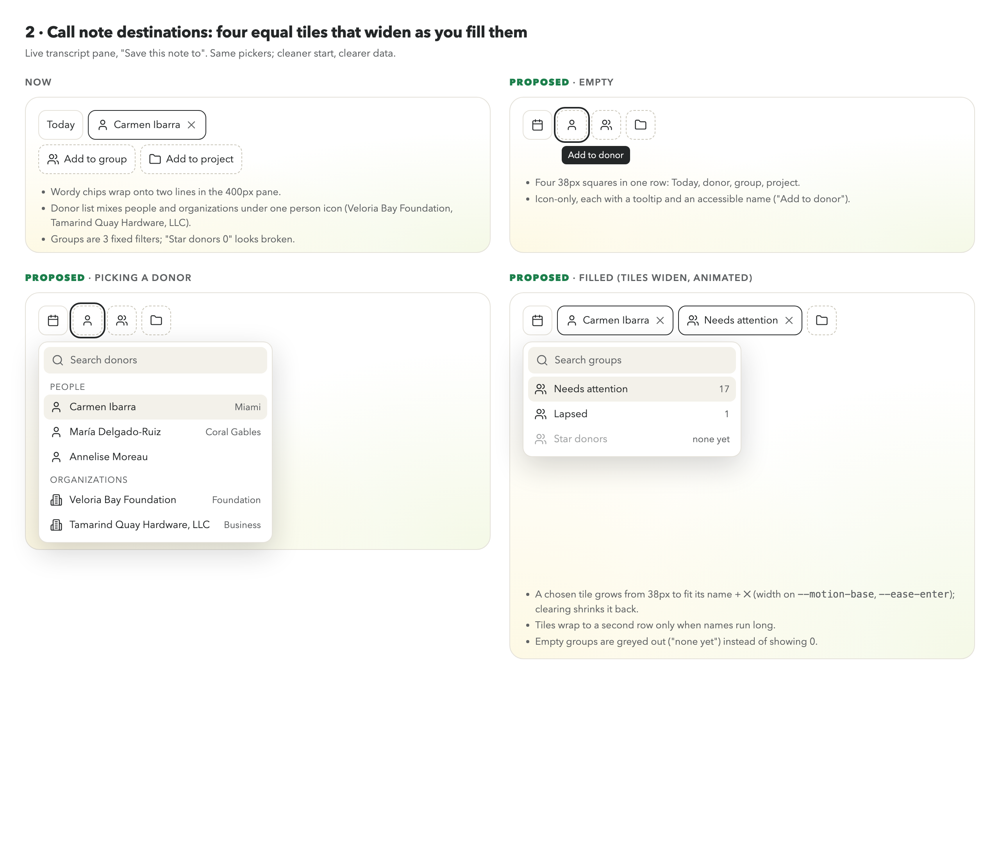
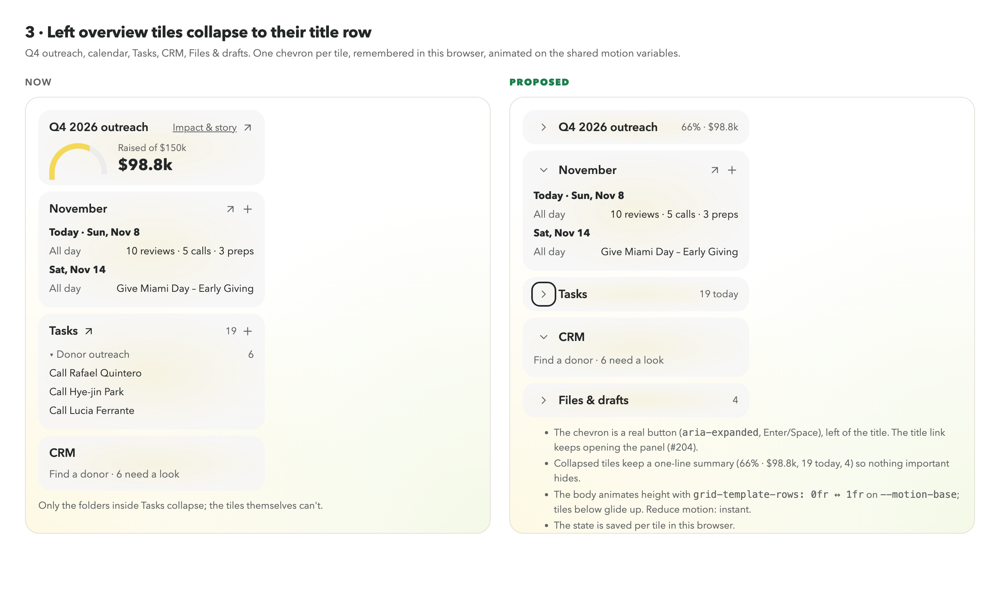

# Home polish: three proposals (mockups, not built yet)

Static mockups for review before anyone builds. Open `mockups/home-polish/index.html`
(`#sample`, `#dest`, `#tiles`) or see the PNGs beside it. Everything animated uses the
shared motion variables from `web/src/index.css` ("Motion", #217): `--motion-*` speeds and
`--ease-*` curves, and nothing moves when Reduce motion is on.

## 1. "Sample data": from a floating pill to the profile menu

- **Today:** a "Sample data" pill sits above every page of the public sample build
  (`layout/SampleDataBadge.tsx` in `Header.tsx`, `MobileHeader.tsx`, `MobileLayout.tsx`).
  It reads as a stray artifact, and `docs/design/workspace-sidebar.md` already says the
  header shouldn't show it.
- **Proposal:** remove the pill. The first line of the profile menu says
  **"Sample data · read-only"** ("Every name and amount is made up. Changes stay in this
  browser."), on the snapshot build only.
- **Rule 9 ("Name the limits. Never present a mock as live.") still holds.** The limit is named
  in the profile menu, in the landing's "Sample run (cached)" dialog, in the tour card ("This is
  the sample desk"), as "Sample goal" on the Q4 tile, and in the mutation dialogs.
  Open question: is that enough on phone pages, or should phones keep a quieter label?

## 2. Call note destinations: four equal tiles that widen as you fill them

- **Today** (`voice/DestinationChips.tsx`, options built in `voice/LiveTranscriptPane.tsx`):
  - **Donor:** every record from `/donors`, so organizations (Veloria Bay Foundation,
    Tamarind Quay Hardware, LLC, Whitaker Family Charitable Fund) show with the same person icon.
  - **Group:** three fixed filters in `voice/donorGroups.ts`: Needs attention
    (lapsing or lapsed), Star donors (`is_star`) and Lapsed. "Star donors 0" looks broken.
  - **Project:** the campaigns list. On the sample build that's one campaign.
  - The worded chips wrap onto two lines in the 400px pane.
- **Proposal:**
  - Start as four 38px square tiles in one row: Today, donor, group, project. Each is icon-only,
    with a tooltip and an accessible name ("Add to donor").
  - Picking one widens that tile to its name plus ✕ (width on `--motion-base` with `--ease-enter`).
    Clearing it shrinks it back.
  - The donor picker splits into **People** and **Organizations**. Organizations use a building
    icon (`donor_type = organization`) and show their kind (Foundation, Business) where the data
    has one.
  - Groups with no members are greyed out ("none yet") instead of showing 0.

## 3. Left overview tiles collapse to their title row

- **Today:** only the folders inside Tasks collapse. The tiles (Q4 outreach, calendar, Tasks,
  CRM, Files & drafts) are always open.
- **Proposal:**
  - Each tile gets a chevron button left of its title (`aria-expanded`, Enter and Space). The
    title link keeps opening its panel, as in #204.
  - A collapsed tile keeps a one-line summary (66% · $98.8k, 19 today, 4 files), so nothing
    important hides.
  - The body animates its height with `grid-template-rows: 0fr ↔ 1fr` on `--motion-base`, and the
    tiles below glide up. With Reduce motion it's instant.
  - The state is saved per tile in this browser.
  - Builds on #204, which changes the same tile headers.
