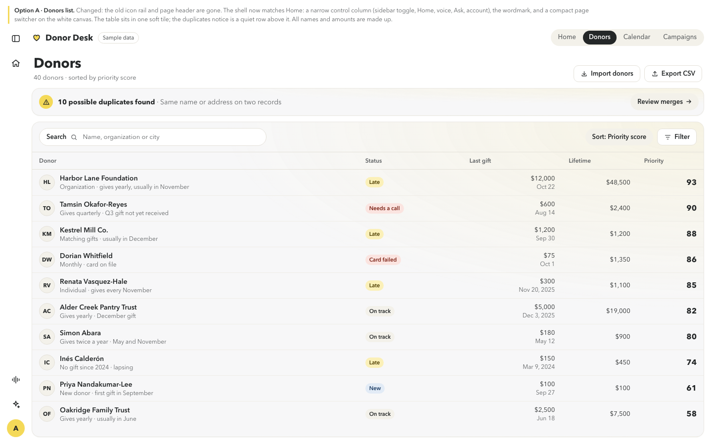
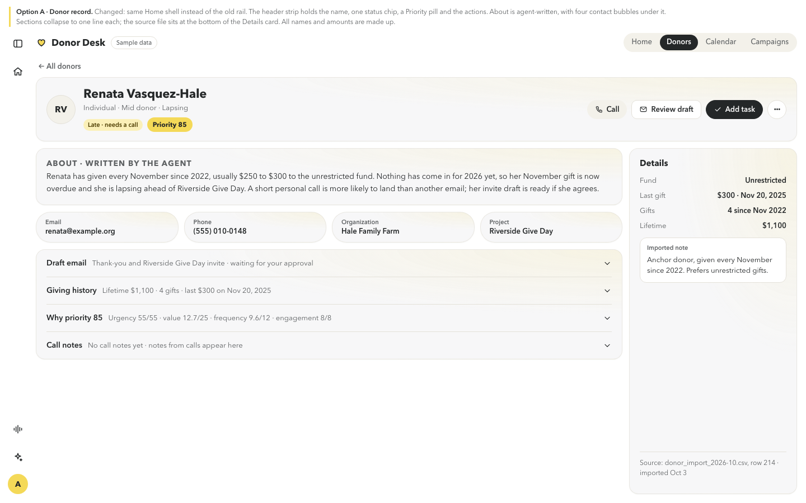
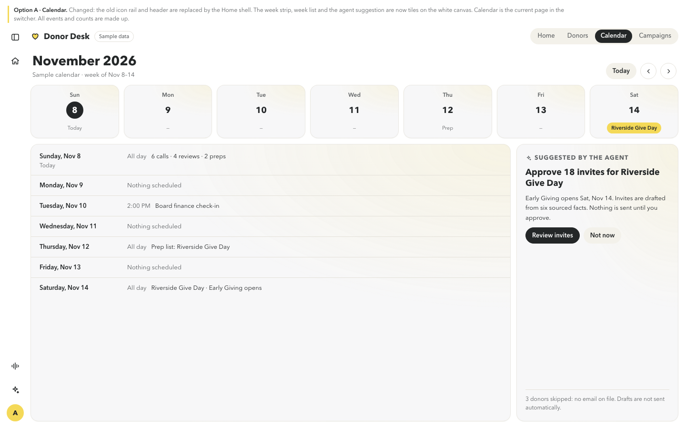
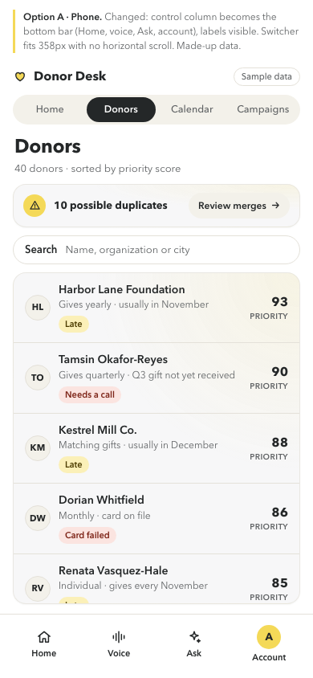

# Every page matches Home: shell mockups (preview only, not built)

Christian: "Donors, the donor record and Calendar still show the old left tab bar from the
previous design. Home is the main design style; clean the other pages up so they match."

Open `mockups/shell/index.html` (`#donors`, `#record`, `#calendar`, `#donors-phone`). All names
and amounts are made up. The pill in the mockups predates #233, which moves "Sample data" into the
profile menu.

## What changes (option A)
- **One shell everywhere.** The same narrow control column as Home (sidebar toggle, Home, voice,
  Ask, account) and the "Donor Desk" wordmark. The old icon rail (`layout/Rail.tsx`) and the
  yellow header buttons go.
- **Getting between pages.** Home's tile titles already open Calendar, CRM and Tasks. Other pages
  add a quiet segmented switcher, **Home · Donors · Calendar · Campaigns**, with the current page dark.
- **Content in Home's tiles.** On Donors, the table sits in one soft tile and the duplicates notice
  is a quiet row. On Calendar, the week strip, week list and agent suggestion are tiles. The donor
  record follows #256: header strip, About, four bubbles, collapsible sections, and a Details card
  with the source file at the bottom.
- **Phone.** The control column becomes the labeled bottom bar, the switcher fits 358px, and the
  gutters are 16px.

## Donors

## Donor record

## Calendar

## Phone

Touches `layout/Layout.tsx`, `layout/Rail.tsx`, `layout/Header.tsx` and `layout/MobileLayout.tsx`
when built. Sequenced with Sharif's UI agent, and after the freeze.
