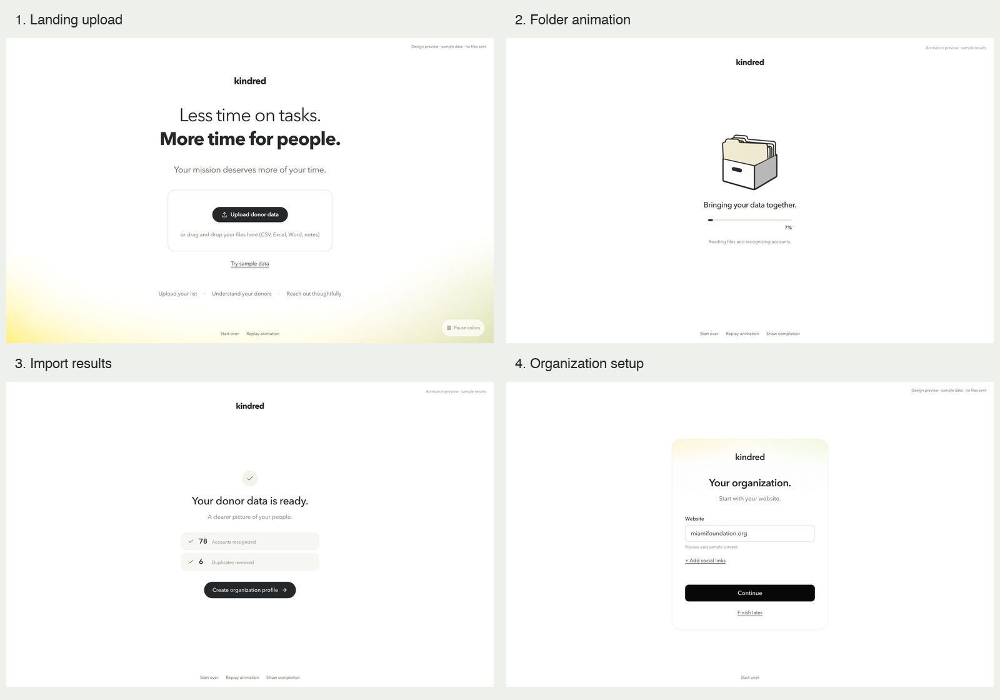

# Donor upload flow

Connects the existing Kindred landing upload to centered processing, compact import results, and the redesigned organization-profile card. The same processing UI is used by first-run file imports. Organization setup follows the approved still: a compact white card, a faint yellow/green haze inside its top edge, a website field, optional social links and a black Continue button. Continue opens the dashboard immediately; the old context receipt/welcome page and the organization step-count footer are removed. Website research and task generation finish in the background.

## Behavior

- Five layered raster folders shuffle inside the drawer on a 3-second cycle. The outermost folder was removed after visual review to prevent it protruding beyond the drawer.
- Estimated progress stays below 100 until ingest succeeds. Fast imports retain a 3.2-second minimum presentation; a brief 100% state precedes the results.
- Two short stacked tiles show accounts recognized first and confirmed duplicate source records consolidated second. Possible duplicate suggestions remain a separate review note. Older services without `duplicates_removed` show a completed check without inventing a removal count.
- The organization card preserves website/social URL validation, prefilling and persistence. Invalid collapsed social fields reopen automatically.
- “Create organization profile” saves the landing import summary and opens organization setup at step 2, without asking for the files again. Existing import failure/retry forms remain in place.
- White background, the landing font stack, pale folders and the black pill CTA carry the approved visual direction through the transition. Reduced-motion preferences disable the folder animation.

## Local review

Run `npm run dev:demo` from `web/`, then use the port printed by Vite:

- `/#/welcome`: existing landing page.
- `/design/upload-flow/index.html`: full labeled click-through beginning at the landing. Click Upload donor data to start the 12-second preview, then continue from results to organization setup. Start over, Replay and Show completion controls are available.
- `/design/upload-flow/index.html?state=loading`: continuous animation for visual review.
- `/design/upload-flow/index.html?state=complete`: completion/results preview.
- `/design/upload-flow/index.html?state=organization`: organization card preview.

The preview uses sample counts and sends no files. Its profile button opens the actual organization setup screen. Normal file imports continue to require the existing configured live ingest service; the hosted snapshot remains read-only. The preview harness is a separate development HTML entry and is not part of the normal demo production entry.

## Evidence

- [Landing](./01-landing.png)
- [Processing](./02-loading.png)
- [Results](./03-results.png)
- [Organization setup](./04-organization.png)
- [Direct dashboard handoff](./05-dashboard.png)
- [Organization card QA](./organization-qa.md)
- [Approved organization still](./approved-organization.png)
- [Original upload QA](./design-qa.md)
